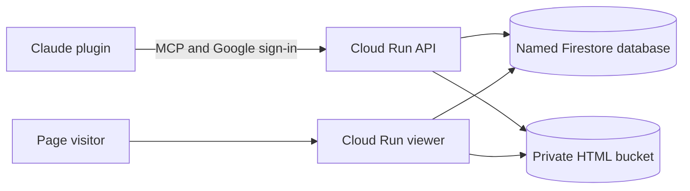

# Artifact Publisher

Publish an HTML page from Claude and give someone a link. Update the page later without changing that link, add a password or expiry date, or take it offline.

Artifact Publisher includes a Claude plugin, an MCP server, and a public page viewer. You host the services in your own Google Cloud project. Publishers sign in with Google; people opening a shared page don't need an account.

This repository contains reusable source and example settings. It doesn't connect to a hosted service. An administrator must deploy it and build a configured plugin before anyone can publish.

## What it does

- Publishes complete HTML pages with embedded assets or public asset URLs.
- Keeps version history and lets you restore an earlier version.
- Supports password protection, link expiry, and replacement links.
- Uses custom domains, with exact DNS instructions for Squarespace.
- Checks missing Google Cloud permissions and explains how an administrator can grant them.
- Restricts publishing to allowed, verified Google accounts.

Pages run in the viewer's browser. They can load JavaScript, including public CDN scripts. The publisher doesn't provide a backend for those pages or upload separate asset files.

## Try it locally

Install Python 3.12+ and [uv](https://docs.astral.sh/uv/), then run:

```bash
git clone https://github.com/IlyasKhallouki/hostArtifact.git
cd hostArtifact
make setup
make check
```

Start the API and viewer in separate terminals:

```bash
make dev-api       # MCP: http://localhost:8080/mcp
make dev-viewer    # Pages: http://localhost:8081
```

Both processes use `server/.localdata`. Development mode uses a fixed local identity and requires no Google credentials. Cloud Run rejects development authentication.

For a complete local publishing test:

```bash
uv run --project server python scripts/local_acceptance.py
```

## Deploy your own instance

Start with the [administrator guide](docs/ADMIN_GUIDE.md). You'll need a Google Cloud project with billing, permission to provision the resources, and a Google OAuth web client. A custom domain also requires access to its DNS settings.

```bash
cp infra/config.env.example infra/config.env
# Fill in your project, account allowlist, bucket and branding.
uv run --project server publisher-admin preflight --profile bootstrap
infra/bootstrap.sh --dry-run
```

`infra/config.env` is ignored by Git. Keep OAuth credentials and signing keys in Secret Manager. The infrastructure commands show plans by default; `--apply` performs the changes.

The committed plugin uses `publisher.example.com` as a placeholder. After deploying, run `make plugin-zip` to build a plugin with your API URL in `dist/`. Share that ZIP with your users. The generator leaves the committed template alone.

## How it fits together



The API and viewer use separate origins and service accounts. HTML lives in a private GCS bucket; only the viewer serves it. Firestore stores page metadata, audit records, domain settings, and encrypted OAuth state.

## Documentation

- [Administrator guide](docs/ADMIN_GUIDE.md): deployment, access, domains, updates and troubleshooting.
- [Sharing pages](docs/COLLEAGUE_GUIDE.md): a short guide for people using the plugin.
- [Architecture](docs/ARCHITECTURE.md): authentication, storage and the public viewer.
- [Behavior reference](docs/SPEC.md): tools, access rules and domain behavior.
- [Design decisions](docs/DECISIONS.md): implementation choices and their tradeoffs.
- [Security and privacy](SECURITY.md): data handling and what to keep out of Git.

## Limits

This implementation is intended for a small shared publishing catalog. Metadata transactions read the catalog, and password rate limits run separately on each viewer instance. Review those choices before using it for a large or high-traffic service. A link is a bearer credential: anyone who receives an unprotected link can open the page.

Google Cloud charges for the services you provision. The API keeps one instance warm, and the default custom-domain setup uses a load balancer. Review current pricing before applying the infrastructure plan.

## License

This repository does not currently include an open-source license. The plugin manifest retains its `Proprietary` designation.

## Analytics

[Optional Umami integration](docs/UMAMI.md) registers each published page and returns a link to its dashboard. Updates keep the same history. Existing pages can be registered with the admin sync command.
