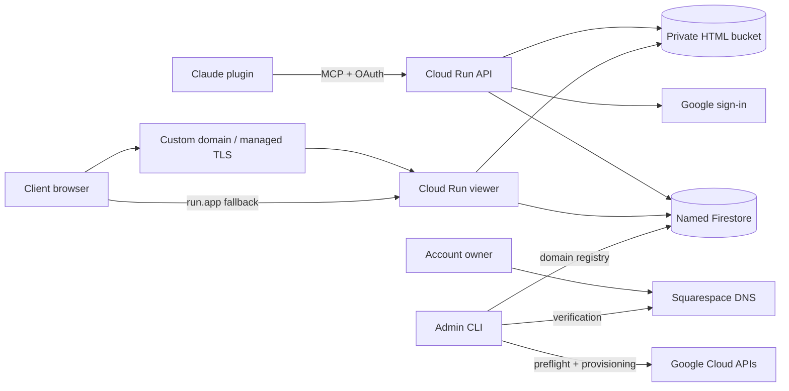

# Architecture

The MCP API and viewer use separate origins and service accounts. Untrusted artifact JavaScript never shares an origin with OAuth routes. Both services use one image digest and one named Firestore database; HTML is in private immutable GCS objects.

GoogleProvider implements the OAuth proxy with client registration, PKCE and consent. Google identity claims are checked on each list/call request. Blocked users see only whoami. Shared OAuth state uses py-key-value's named Firestore store, `oauth_` collection prefixes and Fernet encryption; the signing key and encrypted state survive replicas/restarts.

Metadata collections are clients, artifacts, versions, domains and audit. Transactions take a shared lock document, read the small catalog, and write only changed documents plus append-only audit events. Blob uploads precede metadata commits using unique immutable attempt paths, so retries cannot collide; unsuccessful transactions can leave safe orphan objects. Permanent deletion removes public metadata before deleting objects.

The viewer checks exact hosts, path/token/status, canonical domain, expiry and signed password sessions before serving HTML. Sessions contain artifact access-version values, expire after 12 hours and are invalidated by access changes. Password hashes are Argon2id; plaintext generated passwords are returned once. HTML is cached by immutable blob key; metadata is read fresh. Domain defaults are snapshotted at publication.

Admin discovery is read-only and reports source coverage. Domain provisioning is resumable and uses deterministic publisher-owned resource names. A shared load balancer routes to the viewer; per-domain DNS authorizations and certificates produce exact Squarespace records. Registry activation requires record sets on two resolvers, certificate readiness, valid TLS and this viewer's health response. Domain removal refuses references and retains infrastructure for separately reviewed cleanup.

The local backend uses process-safe file locking and atomic JSON replacement, plus immutable files for HTML. It implements the same metadata/blob interfaces as cloud backends. Local tests cover behavior, concurrency and the OAuth discovery contract; live cloud/browser acceptance remains a separate deployment gate.
